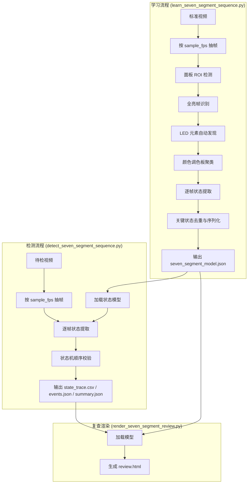
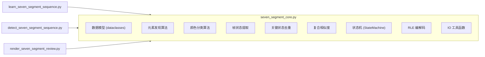

# Design Document: Seven-Segment Sequence Inspection

## Overview

本设计文档描述 **七段管测试序列检测系统** 的技术架构与实现方案。

系统采用"标准视频学习 → 状态模型持久化 → 待检视频校验"的三阶段流水线，
与跑马灯原型（`running_led_core.py`）架构思路一致但**完全独立实现**。

核心差异点：
- **颜色感知**：不仅判断亮灭，还判断颜色是否正确（CYAN/GREEN/RED）
- **异构元素**：面板包含七段管段、阶梯条、点状 LED、扫描条等不同形态元素
- **复合相似度**：同时考虑亮灭匹配和颜色匹配的加权相似度

### 系统流程图



## Architecture

### 模块划分

系统由 4 个 Python 脚本组成，核心算法集中在 `seven_segment_core.py`：



### 职责分离

| 脚本 | 职责 |
|------|------|
| `seven_segment_core.py` | 所有算法、数据模型、工具函数 |
| `learn_seven_segment_sequence.py` | 视频 IO、学习流程编排、CLI 参数解析 |
| `detect_seven_segment_sequence.py` | 视频 IO、检测流程编排、CLI 参数解析 |
| `render_seven_segment_review.py` | HTML 生成、base64 图片编码、模板渲染 |

### 依赖

- Python 3.9+
- OpenCV (`cv2`) — 视频读取、图像处理
- NumPy — 数值计算
- 标准库：`json`, `csv`, `pathlib`, `argparse`, `dataclasses`, `base64`, `datetime`
- **不依赖** `running_led_core.py` 或任何跑马灯原型代码

## Components and Interfaces

### 核心函数签名 (`seven_segment_core.py`)

#### 数据模型

```python
@dataclass
class ElementPosition:
    """单个 LED 元素的位置信息"""
    id: str                    # 唯一标识，如 "seg_0_a", "dot_12", "bar_3", "scanbar"
    roi: tuple[int, int, int, int]  # (x, y, w, h) 在面板坐标系中
    element_type: str          # "segment" | "bar" | "dot" | "scanbar"
    group: str                 # 所属组，如 "digit_0", "staircase", "dots", "scanbar"

@dataclass
class ColorEntry:
    """调色板中的一个颜色条目"""
    code: str                  # "CYAN" | "GREEN" | "RED" | "OFF"
    hsv_center: tuple[float, float, float]  # H, S, V 中心值
    hsv_tolerance: tuple[float, float, float]  # H, S, V 容差半径
    sample_count: int          # 学习时的样本数

@dataclass
class ElementState:
    """单个元素在某帧的状态"""
    on: bool
    color_code: str            # "CYAN" | "GREEN" | "RED" | "OFF" | "unknown"

@dataclass
class FrameState:
    """一帧的完整状态向量"""
    states: list[ElementState]  # 按 element 固定顺序排列
    confidence: float           # 成功解码的元素比例 (0.0~1.0)

@dataclass
class KeyState:
    """一个关键状态"""
    id: str                    # "K000", "K001", ...
    index: int
    frame_state: FrameState
    on_off_rle: str            # 亮灭向量的 RLE 编码
    color_vector: list[str]    # 颜色码向量
    median_hold_frames: int
    max_hold_frames: int
    thumbnail: str             # 相对路径

@dataclass
class Thresholds:
    """所有阈值的集合"""
    sample_fps: float = 15.0
    element_on_threshold: float = 0.35
    color_match_tolerance: float = 0.25
    dedupe_similarity: float = 0.985
    state_similarity: float = 0.95
    min_stable_frames: int = 2
    transition_tolerance_frames: int = 3
    hold_timeout_factor: float = 2.5
    max_unknown_frames: int = 3
    panel_lost_threshold: float = 0.5

@dataclass
class SevenSegmentModel:
    """完整状态模型"""
    schema: str = "seven_segment_sequence_inspection.v1"
    created_at: str = ""
    source_video: str = ""
    elements: list[ElementPosition] = field(default_factory=list)
    palette: list[ColorEntry] = field(default_factory=list)
    thresholds: Thresholds = field(default_factory=Thresholds)
    key_states: list[KeyState] = field(default_factory=list)
    sequence: list[str] = field(default_factory=list)

@dataclass
class TraceRow:
    """state_trace.csv 的一行"""
    frame_index: int
    time_sec: float
    expected_state: str
    matched_state: str
    next_state: str
    similarity_current: float
    similarity_next: float
    transition: str            # "stay" | "advance" | "unknown_transition" | "error"
    hold_frames: int
    ok: bool
    event_type: str

@dataclass
class AnomalyEvent:
    """一条异常事件"""
    frame_index: int
    time_sec: float
    type: str                  # "missing_element" | "wrong_color" | "skipped_state" |
                               # "wrong_order" | "stuck_state" | "missing_state" |
                               # "unknown_state" | "panel_lost"
    expected_state: str
    matched_state: str
    message: str
    element_id: str = ""       # 仅 missing_element / wrong_color 使用
    observed_color: str = ""   # 仅 wrong_color 使用
    expected_color: str = ""   # 仅 wrong_color 使用
```

#### 元素发现

```python
def detect_panel_roi(frame: np.ndarray) -> tuple[int, int, int, int]:
    """检测面板区域 ROI (x, y, w, h)。失败时 raise ValueError。"""

def find_all_bright_frame(
    frames: list[tuple[int, np.ndarray, float]],
    panel_roi: tuple[int, int, int, int],
    min_bright_ratio: float = 0.3
) -> tuple[int, np.ndarray]:
    """从采样帧中找到亮元素最多的帧（全亮帧）。返回 (frame_index, frame)。
    如果没有帧的亮元素比例超过 min_bright_ratio，raise ValueError。"""

def discover_elements(
    bright_frame: np.ndarray,
    panel_roi: tuple[int, int, int, int]
) -> list[ElementPosition]:
    """从全亮帧中发现所有 LED 元素位置。
    使用连通域分析 + 形态学，按面积/形状分类为 segment/bar/dot/scanbar。
    返回按固定顺序排列的元素列表。"""
```

#### 颜色分类

```python
def learn_palette(
    frames: list[tuple[int, np.ndarray, float]],
    elements: list[ElementPosition],
    panel_roi: tuple[int, int, int, int],
    max_colors: int = 8
) -> list[ColorEntry]:
    """从标准视频的亮元素中采样 HSV 数据，K-Means 聚类得到调色板。
    始终包含 OFF 条目。"""

def classify_color(
    roi_pixels: np.ndarray,
    palette: list[ColorEntry],
    tolerance: float = 0.25
) -> str:
    """将 ROI 区域的像素分类为最近的颜色码。
    如果与所有颜色的距离都超过 tolerance，返回 "unknown"。"""
```

#### 帧状态提取

```python
def extract_frame_state(
    frame: np.ndarray,
    panel_roi: tuple[int, int, int, int],
    elements: list[ElementPosition],
    palette: list[ColorEntry],
    thresholds: Thresholds
) -> FrameState:
    """对一帧提取完整状态向量。
    对每个元素：裁剪 ROI → 判断亮灭 → 若亮则分类颜色。
    返回 FrameState（含置信度）。"""

def element_is_on(
    roi_pixels: np.ndarray,
    threshold: float = 0.35
) -> bool:
    """判断单个元素 ROI 是否为亮态。
    使用 V 通道的高分位数与阈值比较。"""
```

#### 复合相似度

```python
def composite_similarity(
    state_a: FrameState,
    state_b: FrameState,
    on_off_weight: float = 0.6,
    color_weight: float = 0.4
) -> float:
    """计算两个帧状态的复合相似度。
    = on_off_weight * hamming_similarity(on_off_vectors)
    + color_weight * color_match_ratio(color_vectors, 仅比较双方都亮的元素)
    返回 [0.0, 1.0]。"""

def hamming_similarity(a: np.ndarray, b: np.ndarray) -> float:
    """二值向量的汉明相似度 = 1 - hamming_distance / length。"""

def color_match_ratio(colors_a: list[str], colors_b: list[str], on_a: list[bool], on_b: list[bool]) -> float:
    """在双方都亮的元素中，颜色码匹配的比例。
    如果没有共同亮的元素，返回 1.0（不惩罚）。"""
```

#### 关键状态去重

```python
def deduplicate_key_states(
    frame_states: list[tuple[int, float, FrameState]],
    dedupe_similarity: float = 0.985,
    min_stable_frames: int = 2
) -> list[KeyState]:
    """对时间序列的帧状态去重，提取稳定的关键状态序列。
    候选状态必须连续稳定 min_stable_frames 帧才被接受。"""
```

#### 状态机

```python
class SevenSegmentStateMachine:
    """顺序校验状态机"""

    def __init__(self, model: SevenSegmentModel):
        """初始化状态机，指针置于 K000。"""

    def process_frame(self, frame_state: FrameState, frame_index: int, time_sec: float) -> TraceRow:
        """处理一帧，返回轨迹行。内部更新指针、计数器，必要时产生事件。"""

    def finalize(self) -> list[AnomalyEvent]:
        """检测结束后，检查是否有关键状态从未到达，产生 missing_state 事件。"""

    @property
    def events(self) -> list[AnomalyEvent]: ...

    @property
    def trace(self) -> list[TraceRow]: ...

    @property
    def overall_ok(self) -> bool: ...
```

#### IO 工具

```python
def rle_encode(mask: np.ndarray) -> str:
    """将二值数组编码为 RLE 字符串 "0:5,1:3,0:2,..."。"""

def rle_decode(rle_str: str) -> np.ndarray:
    """将 RLE 字符串解码为 np.int8 数组。"""

def open_video(path: Path) -> tuple[cv2.VideoCapture, int, float, int, int]:
    """打开视频，返回 (cap, frame_count, fps, width, height)。"""

def sample_frames(cap, sample_fps: float, source_fps: float) -> list[tuple[int, np.ndarray, float]]:
    """按 sample_fps 抽帧，返回 [(frame_index, frame, time_sec), ...]。"""

def write_model(path: Path, model: SevenSegmentModel) -> None:
    """将模型序列化为 JSON 写入文件。"""

def load_model(path: Path) -> SevenSegmentModel:
    """从 JSON 加载模型。验证 schema 字段，不匹配则 raise ValueError。"""

def write_trace_csv(path: Path, trace: list[TraceRow]) -> None:
    """将轨迹写入 CSV。"""

def write_events_json(path: Path, events: list[AnomalyEvent]) -> None:
    """将事件列表写入 JSON。"""

def write_summary_json(path: Path, summary: dict) -> None:
    """将摘要写入 JSON。"""
```

### CLI 脚本接口

#### `learn_seven_segment_sequence.py`

```
usage: learn_seven_segment_sequence.py --video PATH --output-dir DIR
                                       [--sample-fps FPS]
                                       [--fixed-panel-size WxH]
                                       [--palette-config PATH]

必选参数:
  --video           标准视频路径
  --output-dir      输出目录

可选参数:
  --sample-fps      采样帧率 (默认 15)
  --fixed-panel-size  固定面板尺寸 WxH (跳过自动检测)
  --palette-config  显式调色板配置 JSON 路径 (跳过自动聚类)
```

#### `detect_seven_segment_sequence.py`

```
usage: detect_seven_segment_sequence.py --video PATH --model PATH --output-dir DIR
                                        [--sample-fps FPS]
                                        [--threshold-state-similarity FLOAT]
                                        [--threshold-dedupe-similarity FLOAT]
                                        [--threshold-transition-tolerance INT]
                                        [--threshold-hold-timeout-factor FLOAT]
                                        [--threshold-max-unknown-frames INT]
                                        [--threshold-panel-lost FLOAT]

必选参数:
  --video           待检视频路径
  --model           状态模型 JSON 路径
  --output-dir      输出目录

可选参数:
  --sample-fps      采样帧率 (覆盖模型中的值)
  --threshold-*     各阈值覆盖参数
```

#### `render_seven_segment_review.py`

```
usage: render_seven_segment_review.py --model PATH --trace PATH --events PATH --output PATH

必选参数:
  --model           状态模型 JSON 路径
  --trace           state_trace.csv 路径
  --events          events.json 路径
  --output          输出 review.html 路径
```

## Data Models

### `seven_segment_model.json` 结构

```json
{
  "schema": "seven_segment_sequence_inspection.v1",
  "created_at": "2026-05-15T14:30:00",
  "source_video": "D:\\jiemi\\七段管\\Video_20260515112415516.avi",
  "elements": [
    {
      "id": "seg_0_a",
      "roi": [120, 50, 45, 12],
      "element_type": "segment",
      "group": "digit_0"
    },
    {
      "id": "dot_01",
      "roi": [300, 200, 8, 8],
      "element_type": "dot",
      "group": "dots"
    },
    {
      "id": "bar_0",
      "roi": [20, 100, 60, 10],
      "element_type": "bar",
      "group": "staircase"
    },
    {
      "id": "scanbar",
      "roi": [10, 450, 970, 15],
      "element_type": "scanbar",
      "group": "scanbar"
    }
  ],
  "palette": [
    {
      "code": "OFF",
      "hsv_center": [0, 0, 0],
      "hsv_tolerance": [180, 255, 30],
      "sample_count": 0
    },
    {
      "code": "CYAN",
      "hsv_center": [103, 200, 220],
      "hsv_tolerance": [7, 50, 50],
      "sample_count": 15420
    },
    {
      "code": "GREEN",
      "hsv_center": [76, 210, 200],
      "hsv_tolerance": [4, 50, 50],
      "sample_count": 3200
    },
    {
      "code": "RED",
      "hsv_center": [7, 220, 230],
      "hsv_tolerance": [5, 50, 50],
      "sample_count": 2800
    }
  ],
  "thresholds": {
    "sample_fps": 15,
    "element_on_threshold": 0.35,
    "color_match_tolerance": 0.25,
    "dedupe_similarity": 0.985,
    "state_similarity": 0.95,
    "min_stable_frames": 2,
    "transition_tolerance_frames": 3,
    "hold_timeout_factor": 2.5,
    "max_unknown_frames": 3,
    "panel_lost_threshold": 0.5
  },
  "key_states": [
    {
      "id": "K000",
      "index": 0,
      "on_off_rle": "0:68",
      "color_vector": ["OFF", "OFF", "OFF"],
      "median_hold_frames": 8,
      "max_hold_frames": 12,
      "thumbnail": "keyframes/K000.png"
    },
    {
      "id": "K001",
      "index": 1,
      "on_off_rle": "1:68",
      "color_vector": ["CYAN", "CYAN", "CYAN"],
      "median_hold_frames": 45,
      "max_hold_frames": 50,
      "thumbnail": "keyframes/K001.png"
    }
  ],
  "sequence": ["K000", "K001", "K002", "K003", "K004", "K005", "K006", "K007", "K008"]
}
```

### `state_trace.csv` 格式

```csv
frame_index,time_sec,expected_state,matched_state,next_state,similarity_current,similarity_next,transition,hold_frames,ok,event_type
0,0.000,K000,K000,K001,0.985,0.120,stay,1,1,
1,0.067,K000,K000,K001,0.990,0.115,stay,2,1,
60,4.000,K000,K001,K002,0.320,0.972,advance,0,1,
```

### `events.json` 格式

```json
{
  "events": [
    {
      "frame_index": 450,
      "time_sec": 30.000,
      "type": "wrong_color",
      "expected_state": "K005",
      "matched_state": "K005",
      "message": "元素 scanbar 颜色错误: 观测 GREEN, 预期 RED",
      "element_id": "scanbar",
      "observed_color": "GREEN",
      "expected_color": "RED"
    }
  ]
}
```

### `summary.json` 格式

```json
{
  "overall_ok": false,
  "frame_count": 1220,
  "sampled_count": 305,
  "event_count": 1,
  "key_state_count": 9,
  "states_reached": ["K000", "K001", "K002", "K003", "K004", "K005"],
  "states_missed": ["K006", "K007", "K008"],
  "first_error": {
    "frame_index": 450,
    "time_sec": 30.000,
    "type": "wrong_color"
  },
  "thresholds_used": {
    "state_similarity": 0.95,
    "dedupe_similarity": 0.985
  },
  "thresholds_overridden": {}
}
```

### 文件结构

```
output/seven_segment_model/
├── seven_segment_model.json
├── keyframes/
│   ├── K000.png
│   ├── K001.png
│   └── ...
└── debug/
    ├── sampled_frames/
    │   ├── frame_000000.jpg
    │   └── ...
    ├── element_overlays/
    │   └── elements_on_bright_frame.png
    └── palette.json

output/seven_segment_run/
├── state_trace.csv
├── events.json
├── summary.json
├── review.html
└── debug/
    ├── sampled_frames/
    │   └── ...
    └── state_overlays/
        └── ...
```

