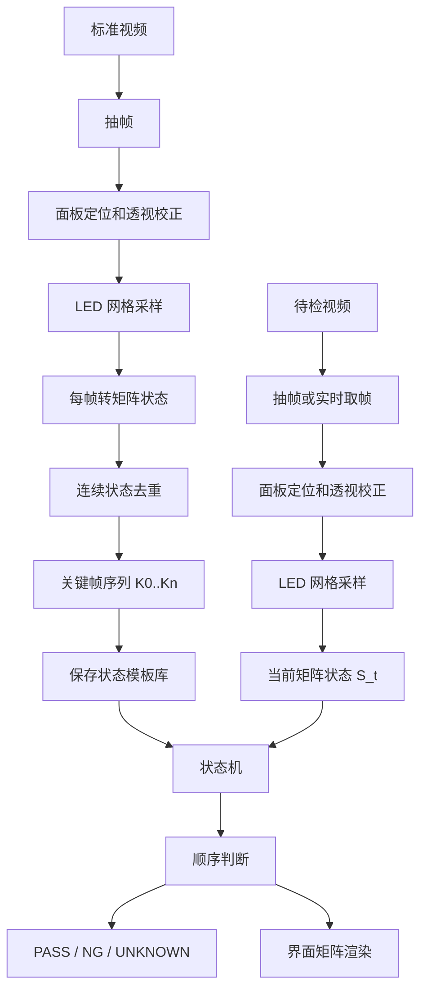
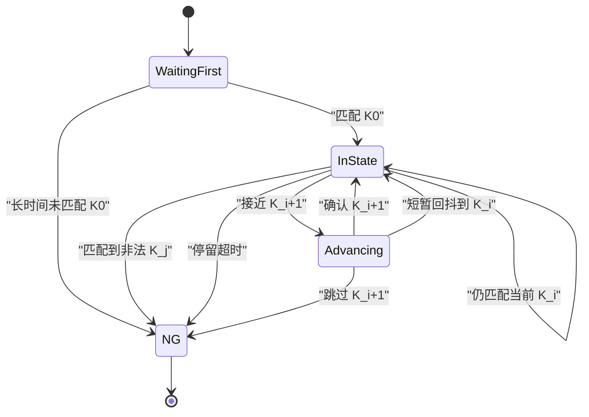

# 跑马灯 LED 状态机检测原型草图

## 目标

把跑马灯检测从“视频画面匹配”改成“LED 矩阵状态序列匹配”。

核心思路：

- 标准视频只用于学习关键状态顺序。
- 检测视频每帧都先转成矩阵状态。
- 界面主视图显示矩阵状态，不以原始视频预览作为主要判断依据。
- 状态机按 `当前关键帧 -> 下一关键帧` 推进，判断是否跳帧、漏帧、倒退、卡住。

## 快速验证

最快验证不需要改客户端，也不需要完整实时流。

1. 准备一条标准跑马灯视频。
2. 抽全帧或高密度抽帧，例如原视频全帧，或每秒 `10~20` 帧。
3. 对每帧做 LED 网格标定，输出二值矩阵 `state[t]`。
4. 对连续相似状态去重，得到关键帧序列 `K0, K1, K2...`。
5. 用另一条视频重复输出 `state[t]`。
6. 用状态机检测 `state[t]` 是否按 `K0 -> K1 -> K2...` 推进。
7. 输出一个离线 HTML 或 MP4：左边关键帧序列，右边当前矩阵状态，底部显示当前关键帧索引和异常。

第一版只做单色亮灭：

- `0` 表示灭。
- `1` 表示亮。
- 不做颜色。
- 不做单颗亮度缺陷，只验证顺序。

验收标准：

- 标准视频回放能自动提取出稳定关键帧序列。
- 同一标准视频重跑，状态推进应全部通过。
- 人为删掉一段帧后，应报 `跳过关键帧` 或 `状态缺失`。
- 人为打乱片段顺序后，应报 `顺序错误`。
- 卡在某个状态超过阈值，应报 `卡状态`。

## 界面原型

```text
┌──────────────────────────────────────────────────────────────────────────────┐
│ 跑马灯状态检测                                      视频: sample_001.avi     │
├───────────────────────────────┬──────────────────────────────────────────────┤
│ 关键帧序列                     │ 当前矩阵状态                                 │
│                               │                                              │
│  ┌──────┐  K000  起始          │  ┌────────────────────────────────────────┐  │
│  │▓▓░░░░│  当前 ✓              │  │ □ □ ■ □ □ □ □ □ □ □ □ □ □ □ □ □ □ □ □ │  │
│  └──────┘                     │  │ □ □ □ ■ □ □ □ □ □ □ □ □ □ □ □ □ □ □ □ │  │
│                               │  │ □ □ □ □ ■ □ □ □ □ □ □ □ □ □ □ □ □ □ □ │  │
│  ┌──────┐  K001  下一步        │  │ □ □ □ □ □ ■ □ □ □ □ □ □ □ □ □ □ □ □ □ │  │
│  │░▓▓░░░│  等待                │  │ □ □ □ □ □ □ ■ □ □ □ □ □ □ □ □ □ □ □ □ │  │
│  └──────┘                     │  │ □ □ □ □ □ □ □ ■ □ □ □ □ □ □ □ □ □ □ □ │  │
│                               │  │ □ □ □ □ □ □ □ □ ■ □ □ □ □ □ □ □ □ □ □ │  │
│  ┌──────┐  K002               │  │ □ □ □ □ □ □ □ □ □ ■ □ □ □ □ □ □ □ □ □ │  │
│  │░░▓▓░░│                     │  └────────────────────────────────────────┘  │
│  └──────┘                     │                                              │
│                               │  当前帧: 01842   当前状态: K000              │
│  ┌──────┐  K003               │  下一状态: K001   相似度: 0.96              │
│  │░░░▓▓░│                     │  状态: PASS       停留: 5 帧                 │
│  └──────┘                     │                                              │
├───────────────────────────────┴──────────────────────────────────────────────┤
│ 时间轴:  K000 ━━━ K001 ━━━ K002 ━━━ K003 ━━━ K004                            │
│ 异常: 无                                                                       │
└──────────────────────────────────────────────────────────────────────────────┘
```

界面重点：

- 左侧是学习出的关键帧序列。
- 右侧是矩阵状态，不是视频预览。
- 原视频可以作为小窗或调试层，但不作为主判断视图。
- 当前状态命中后，左侧高亮推进到下一关键帧。

## 流程图



## 状态机



## 数据结构草案

关键帧模板库：

```json
{
  "version": 1,
  "panel": {
    "rows": 26,
    "cols": 20,
    "slot_count": 509
  },
  "states": [
    {
      "id": "K000",
      "index": 0,
      "mask": "base64_or_rle_binary_matrix",
      "on_count": 37,
      "duration_frames_median": 5
    }
  ],
  "sequence": ["K000", "K001", "K002", "K003"]
}
```

检测帧结果：

```json
{
  "frame_index": 1842,
  "time_sec": 76.75,
  "matched_state": "K000",
  "expected_state": "K000",
  "next_state": "K001",
  "similarity": 0.96,
  "hold_frames": 5,
  "transition": "stay",
  "ok": true
}
```

## 相似度规则

第一版建议用简单、可解释的指标：

```text
similarity = 1 - hamming_distance(current_mask, key_mask) / slot_count
```

推进规则：

- `similarity(current, K_i) >= 0.95`：仍在当前状态。
- `similarity(current, K_i+1) >= 0.95`：推进到下一状态。
- 当前和下一都不达标，但持续帧数很短：标记为过渡帧。
- 匹配到 `K_i+2` 或更后状态：跳状态。
- 匹配到 `K_i-1` 且持续超过阈值：倒退。
- 在 `K_i` 停留超过学习时长上限：卡状态。

阈值第一版可以先保守：

- 状态命中阈值：`0.95`
- 过渡容忍：`2~3` 帧
- 停留超时：标准停留帧中位数的 `2.5x`

## 最小原型任务

1. 离线学习脚本：输入标准视频，输出 `key_states.json` 和关键帧缩略图。
2. 离线检测脚本：输入待检视频和 `key_states.json`，输出 `state_trace.csv`。
3. 可视化脚本：输入 `key_states.json` 和 `state_trace.csv`，生成 HTML 或 MP4。
4. 人工构造异常：删状态、重复状态、打乱状态，验证能不能报错。

## 风险点

- 面板定位不稳会污染所有后续状态。
- 自动关键帧去重如果阈值太低，会把过渡帧也学进去。
- 跑马灯速度变化时，不能用固定帧号，只能用状态推进。
- 多颜色跑马灯需要先把每格从 `0/1` 扩展成 `off/white/red/blue/green`。
- 多面板场景需要每块 panel 独立维护状态机，最后汇总整机结果。

## 建议结论

这个方案适合跑马灯检测，尤其适合先做成离线原型验证。  

第一版不要追求实时，不要做复杂颜色，不要接客户端。先证明这件事：

```text
标准视频 -> 自动提关键状态 -> 待检视频 -> 状态机能正确推进并识别异常
```

这一步跑通以后，再接实时界面和多颜色会更稳。

## 实现边界

第一版只实现离线原型。

必须做：

- 从标准视频学习关键状态序列。
- 从待检视频生成逐帧状态轨迹。
- 用状态机判断顺序是否正确。
- 生成可复查的 `review.html`。

暂时不做：

- 不接 C# 客户端。
- 不做实时相机流。
- 不做颜色判断。
- 不做多面板。
- 不做单颗 LED 亮度缺陷判定。
- 不做模型训练。

第一版只回答一个问题：

```text
待检视频里的 LED 状态变化顺序，是否和标准视频学到的关键状态顺序一致。
```

## 命令行

学习标准视频：

```powershell
python scripts/learn_running_led_states.py `
  --video D:\data\standard_running_led.avi `
  --output-dir D:\led-visual-inspection\output\running_led_model `
  --sample-fps 15 `
  --fixed-panel-size 720x480
```

检测待检视频：

```powershell
python scripts/detect_running_led_sequence.py `
  --video D:\data\test_running_led.avi `
  --model D:\led-visual-inspection\output\running_led_model\key_states.json `
  --output-dir D:\led-visual-inspection\output\running_led_run `
  --sample-fps 15
```

生成复查页面：

```powershell
python scripts/render_running_led_review.py `
  --model D:\led-visual-inspection\output\running_led_model\key_states.json `
  --trace D:\led-visual-inspection\output\running_led_run\state_trace.csv `
  --events D:\led-visual-inspection\output\running_led_run\events.json `
  --output D:\led-visual-inspection\output\running_led_run\review.html
```

## 文件结构

学习输出：

```text
output/running_led_model/
  key_states.json
  keyframes/
    K000.png
    K001.png
    K002.png
  debug/
    sampled_frames/
    state_masks/
    keyframe_contact_sheet.jpg
```

检测输出：

```text
output/running_led_run/
  state_trace.csv
  events.json
  summary.json
  review.html
  debug/
    sampled_frames/
    state_masks/
    matrix_overlays/
```

## 模块拆分

`scripts/learn_running_led_states.py`

- 输入标准视频。
- 抽帧。
- 做面板定位和固定尺寸透视校正。
- 对每帧生成 LED 状态矩阵。
- 合并连续重复状态。
- 输出 `key_states.json` 和关键帧缩略图。

`scripts/detect_running_led_sequence.py`

- 输入待检视频和 `key_states.json`。
- 对每帧生成 LED 状态矩阵。
- 计算当前状态与关键状态的相似度。
- 用状态机推进。
- 输出 `state_trace.csv`、`events.json`、`summary.json`。

`scripts/render_running_led_review.py`

- 输入模型和检测轨迹。
- 生成 `review.html`。
- 页面左侧显示关键帧序列。
- 页面右侧显示逐帧矩阵状态。
- 时间轴标记异常事件。

`scripts/running_led_core.py`

- 放公共算法。
- 包括矩阵编码、相似度、关键帧去重、状态机。
- 三个 CLI 脚本只做 IO 和流程编排。

## 输入输出定义

`key_states.json`

```json
{
  "version": 1,
  "created_at": "2026-05-11T10:30:00",
  "source_video": "D:\\data\\standard_running_led.avi",
  "sample_fps": 15,
  "panel": {
    "rows": 26,
    "cols": 20,
    "slot_count": 509,
    "fixed_size": [720, 480]
  },
  "thresholds": {
    "state_similarity": 0.95,
    "dedupe_similarity": 0.985,
    "transition_tolerance_frames": 3,
    "hold_timeout_factor": 2.5
  },
  "states": [
    {
      "id": "K000",
      "index": 0,
      "on_count": 37,
      "mask_rle": "0:12,1:4,0:8",
      "median_hold_frames": 5,
      "thumbnail": "keyframes/K000.png"
    }
  ],
  "sequence": ["K000", "K001", "K002"]
}
```

`state_trace.csv`

```text
frame_index,time_sec,expected_state,matched_state,next_state,similarity_current,similarity_next,transition,hold_frames,ok,event_type
1842,76.750,K000,K000,K001,0.96,0.42,stay,5,1,
1843,76.792,K000,K001,K002,0.41,0.97,advance,0,1,
```

`events.json`

```json
{
  "events": [
    {
      "frame_index": 2050,
      "time_sec": 85.42,
      "type": "skipped_state",
      "expected_state": "K004",
      "matched_state": "K005",
      "message": "Expected K004 but matched K005"
    }
  ]
}
```

`summary.json`

```json
{
  "overall_ok": false,
  "frame_count": 3200,
  "sampled_count": 1280,
  "event_count": 1,
  "first_error": {
    "frame_index": 2050,
    "type": "skipped_state"
  }
}
```

## 核心算法

### 每帧转矩阵状态

输入是固定尺寸 panel 图。

输出是长度为 `slot_count` 的二值数组：

```text
mask = [0, 0, 1, 0, 1, ...]
```

第一版可以复用已有点位或网格采样逻辑：

- 如果已经有固定 LED 点位，直接在每个点位的小窗口内取亮度。
- 每个点位取局部窗口，例如 `5x5` 或 `7x7`。
- 使用局部窗口内亮度的高分位数，例如 `p90`。
- 对整帧所有点位亮度做归一化。
- 用自适应阈值得到 `on/off`。

建议亮灭判断：

```text
score_i = p90(gray_window_i)
norm_i = score_i / percentile(score_all_slots, 95)
on_i = norm_i >= on_threshold
```

默认：

```text
on_threshold = 0.35
```

如果整帧亮点很少，可以用 Otsu 作为兜底，但第一版要把实际阈值写入 debug 输出。

### 状态相似度

使用汉明相似度：

```text
similarity(a, b) = 1 - hamming_distance(a, b) / slot_count
```

也可以额外记录：

```text
missing = template_on && current_off
extra = template_off && current_on
```

第一版状态推进只依赖 `similarity`，`missing/extra` 用于解释。

### 关键帧去重

学习阶段对连续帧状态去重。

规则：

```text
如果 similarity(state_t, last_key_state) >= dedupe_similarity:
    认为仍然是同一个关键状态
否则:
    新增关键状态
```

默认：

```text
dedupe_similarity = 0.985
```

为了避免过渡帧进入关键状态，新增关键状态前必须连续稳定出现：

```text
min_stable_frames = 2
```

也就是候选状态至少连续出现 `2` 帧，才加入关键帧序列。

### 状态机推进

状态机只允许三种正常行为：

- 留在当前状态 `K_i`
- 推进到下一状态 `K_i+1`
- 短暂未知过渡

伪代码：

```python
current_index = 0
hold_frames = 0
unknown_frames = 0

for frame in sampled_frames:
    current = key_states[current_index]
    next_state = key_states[(current_index + 1) % len(key_states)]

    sim_current = similarity(frame.mask, current.mask)
    sim_next = similarity(frame.mask, next_state.mask)
    best_index, best_similarity = find_best_key_state(frame.mask)

    if sim_current >= state_similarity:
        hold_frames += 1
        unknown_frames = 0
        transition = "stay"
    elif sim_next >= state_similarity:
        current_index = (current_index + 1) % len(key_states)
        hold_frames = 0
        unknown_frames = 0
        transition = "advance"
    elif unknown_frames < transition_tolerance_frames:
        unknown_frames += 1
        transition = "unknown_transition"
    elif best_index not in {current_index, current_index + 1}:
        emit_event("skipped_state" or "wrong_order")
    else:
        emit_event("unknown_state")

    if hold_frames > median_hold_frames[current_index] * hold_timeout_factor:
        emit_event("stuck_state")
```

## 默认阈值

```text
sample_fps = 15
on_threshold = 0.35
dedupe_similarity = 0.985
state_similarity = 0.95
min_stable_frames = 2
transition_tolerance_frames = 3
hold_timeout_factor = 2.5
max_unknown_frames = 3
```

这些阈值必须写入 `key_states.json`，检测时默认读取模型里的阈值。

## 异常类型

`panel_lost`

检测不到 panel，或有效 LED 点位不足。

`unknown_state`

当前帧既不像当前状态，也不像下一状态，且超过过渡容忍帧数。

`skipped_state`

当前帧最像 `K_i+2` 或更后的状态，说明跳过了下一关键状态。

`wrong_order`

当前帧最像已经过去的状态，且持续超过容忍帧数。

`stuck_state`

当前状态停留时间超过学习到的中位停留帧数乘以 `hold_timeout_factor`。

`missing_state`

整段检测结束后，有关键状态从未被确认到达。

`unstable_state`

当前状态在多个关键状态之间频繁抖动，持续超过窗口阈值。

## HTML 复查页面要求

`review.html` 必须是单文件，能直接打开。

页面区域：

- 左侧：关键帧序列缩略图。
- 右侧：当前帧矩阵状态。
- 底部：时间轴和异常事件。
- 右上：当前帧号、时间、当前状态、下一状态、相似度、PASS/NG。

颜色语义：

```text
亮格: amber
灭格: dark gray
当前关键帧: green outline
下一关键帧: blue outline
异常关键帧: red outline
unknown_transition: yellow marker
NG event: red marker
```

交互第一版只需要：

- 播放/暂停
- 前后一帧
- 跳到下一个异常
- 点击关键帧跳转到首次命中的帧

## 测试计划

基础测试：

- 用标准视频学习，再用同一视频检测，应无 NG。
- 用同一视频截取中间一段检测，应能从 `K0` 或最近状态开始推进。
- 用不同采样率重跑，关键状态序列数量应基本一致。

人工异常：

- 删除某个关键状态对应片段，应报 `missing_state` 或 `skipped_state`。
- 重复某个状态片段，应报 `stuck_state`。
- 交换两个片段顺序，应报 `wrong_order`。
- 插入黑帧，应报 `unknown_state` 或 `panel_lost`。
- 降低整体亮度，应尽量不报错，除非低到无法判断。

通过标准：

- 标准视频自检 `overall_ok = true`。
- 至少三种人工异常能被检出。
- `review.html` 能定位到第一处异常。
- 输出文件字段稳定，后续客户端可以直接消费。

## 实现任务清单

1. 新增 `scripts/running_led_core.py`
   提供矩阵编码、RLE、相似度、关键帧去重、状态机。

2. 新增 `scripts/learn_running_led_states.py`
   从标准视频生成 `key_states.json`。

3. 新增 `scripts/detect_running_led_sequence.py`
   从待检视频生成 `state_trace.csv`、`events.json`、`summary.json`。

4. 新增 `scripts/render_running_led_review.py`
   生成可打开的 `review.html`。

5. 增加最小测试数据脚本
   从标准状态轨迹人工构造删帧、重复、乱序三类异常。

6. 写一个 README 示例
   放命令行、输出文件说明和第一版限制。
