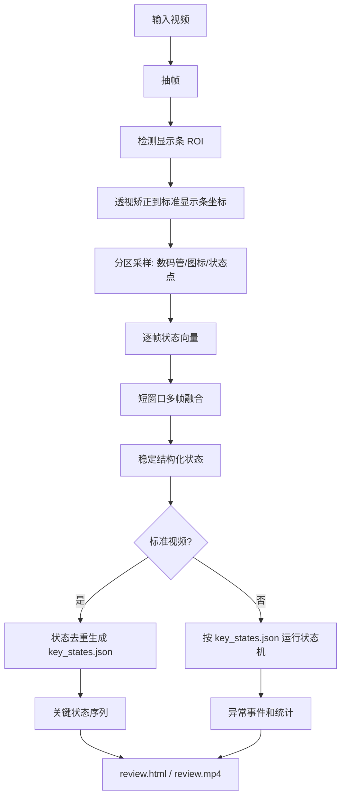

# 数码管/稀疏指示灯状态机检测设计文档

## 背景

目标视频示例：

`D:/jiemi/Video_20260430154222007.avi`

视频信息：

- 分辨率：`2448 x 2048`
- 帧数：`318`
- 帧率：约 `7.5 fps`
- 时长：约 `42.36s`
- 画面主体：手持式黑色显示条，包含数码管、图标、小圆点/状态灯

这个视频和之前的密集 LED 矩阵不是同一类问题。之前的检测目标是规则点阵中的每一颗 LED；这个视频的目标是一个显示面板上的结构化状态，例如数字、图标、状态点。

因此不能直接复用密集 LED 点位模板匹配方案。可以复用视频抽帧、ROI 矫正、时间线输出、异常汇总、HTML/视频预览这些外围能力。

## 核心结论

这类视频仍然适合使用“关键帧 + 状态机”的方案，但状态表达方式必须改变。

密集点阵方案：

```text
frame -> LED 坐标点亮情况 -> rows x cols 二值矩阵 -> 状态机
```

本方案：

```text
frame -> 显示条 ROI -> 数码管/图标/状态点解码 -> 结构化状态 -> 状态机
```

结构化状态示例：

```json
{
  "digits": "88",
  "digit_segments": [
    "abcdefg",
    "abcdefg"
  ],
  "left_icons": {
    "icon_01": true,
    "icon_02": false
  },
  "right_icons": {
    "power": true,
    "mode": true
  },
  "bottom_dots": [true, true, false, false, true],
  "confidence": 0.93
}
```

## 第一阶段目标

先做离线原型，不直接接客户端。

输入：

- 一条标准视频
- 一条或多条待测视频

输出：

- `display_roi_debug/`：显示条定位和矫正预览
- `state_trace.csv`：逐帧状态结果
- `key_states.json`：从标准视频学习出的关键状态序列
- `events.json`：异常事件
- `summary.json`：统计结果
- `review.html`：人工复核页面
- `review.mp4`：可选，带状态覆盖层的视频

第一版只做：

- 检测显示条 ROI
- 解码数码管段位
- 解码主要图标/状态点亮灭
- 多帧融合，解决刷新频闪
- 状态去重
- 状态机顺序判断

第一版不做：

- OCR 识别所有中文文字
- 复杂反光修复
- 手部遮挡恢复
- 颜色分类
- 客户端实时检测

## 为什么不能单帧硬判

从示例视频看，显示条存在明显刷新频闪。很多帧不是完整显示状态，而是某些段位/图标瞬间缺失。

如果逐帧直接判断，会出现：

- 数码管缺段，`8` 被误判为 `0`、`6`、`9`
- 图标时亮时灭，造成假异常
- 高亮过曝，多个相邻元素粘连
- 手持移动导致 ROI 轻微漂移

因此必须做短窗口融合。

推荐默认窗口：

- `window_size = 5` 帧
- `min_on_ratio = 0.4`
- `stable_confirm_frames = 2`

含义：

- 连续 5 帧内某个段位有 40% 以上帧为亮，则认为该段位亮
- 状态至少连续确认 2 次，才推进状态机

## 总体流程



## 模块划分

建议新建独立模块，不直接改当前密集点阵检测主流程。

```text
scripts/
  display_panel_core.py
  learn_display_states.py
  detect_display_sequence.py
  render_display_review.py
```

### `display_panel_core.py`

职责：

- 读取视频帧
- 定位显示条 ROI
- 对显示条做透视矫正
- 在标准坐标系中采样各检测区域
- 输出结构化状态
- 提供状态相似度计算

关键函数建议：

```python
def find_display_roi(frame) -> DisplayRoi | None:
    ...

def warp_display_panel(frame, roi) -> np.ndarray:
    ...

def decode_display_state(warped_panel, layout) -> DisplayState:
    ...

def fuse_states(states, window_size=5, min_on_ratio=0.4) -> DisplayState:
    ...

def state_similarity(a: DisplayState, b: DisplayState) -> float:
    ...
```

### `learn_display_states.py`

职责：

- 输入标准视频
- 输出关键状态序列
- 自动去除重复状态
- 保存每个关键状态的预览图

建议命令：

```powershell
python scripts/learn_display_states.py `
  --video D:\jiemi\Video_20260430154222007.avi `
  --layout configs/display_panel_layout.json `
  --out output/display_state_model/Video_20260430154222007
```

输出：

```text
output/display_state_model/Video_20260430154222007/
  key_states.json
  key_state_previews/
  roi_debug/
  learn_summary.json
```

### `detect_display_sequence.py`

职责：

- 输入待测视频
- 加载标准关键状态序列
- 对待测视频逐帧解码
- 运行状态机
- 输出异常事件

建议命令：

```powershell
python scripts/detect_display_sequence.py `
  --video D:\jiemi\test.avi `
  --model output/display_state_model/Video_20260430154222007/key_states.json `
  --layout configs/display_panel_layout.json `
  --out output/display_detection/test
```

输出：

```text
output/display_detection/test/
  state_trace.csv
  events.json
  summary.json
  overlays/
```

### `render_display_review.py`

职责：

- 生成人工复核页面
- 左侧显示关键状态序列
- 右侧显示当前检测视频帧和标准化状态图
- 时间轴标记异常

建议命令：

```powershell
python scripts/render_display_review.py `
  --detection output/display_detection/test `
  --out output/display_detection/test/review.html
```

## 显示条 ROI 定位

第一版优先用几何和亮度，不建议上深度学习。

推荐逻辑：

1. 在暗背景中找高亮区域。
2. 过滤过小噪声。
3. 取高亮区域的外接矩形。
4. 向外扩展边界，包含黑色显示条完整边缘。
5. 用最小外接四边形或旋转矩形估计显示条角度。
6. 透视矫正到固定尺寸，例如 `640 x 160`。

注意：

- 不能只裁高亮数字，否则图标位置会丢失。
- 不能按白色外壳定位，因为外壳大、角度变化、遮挡多。
- ROI 应该以黑色显示条为目标。
- 边界要留 padding，避免裁掉右侧图标和底部小点。

推荐 ROI padding：

```text
left:   8%
right:  8%
top:    20%
bottom: 20%
```

## 标准布局配置

需要一个布局文件描述标准显示条坐标中的检测区域。

文件：

`configs/display_panel_layout.json`

示例：

```json
{
  "panel_size": [640, 160],
  "digits": [
    {
      "name": "digit_1",
      "segments": {
        "a": [260, 28, 320, 42],
        "b": [320, 38, 336, 76],
        "c": [320, 84, 336, 122],
        "d": [260, 118, 320, 134],
        "e": [244, 84, 260, 122],
        "f": [244, 38, 260, 76],
        "g": [260, 74, 320, 90]
      }
    }
  ],
  "icons": {
    "left_01": [80, 74, 112, 96],
    "power": [470, 48, 502, 80],
    "right_01": [520, 72, 552, 100]
  },
  "dots": {
    "bottom_01": [70, 124, 82, 136],
    "bottom_02": [110, 124, 122, 136]
  }
}
```

第一版可以手工标注布局。等流程跑通后，再做自动或半自动标注。

## 数码管解码

每个数码管按 7 段采样。

段位：

```text
  a
f   b
  g
e   c
  d
```

数字映射：

```json
{
  "0": "abcdef",
  "1": "bc",
  "2": "abged",
  "3": "abgcd",
  "4": "fgbc",
  "5": "afgcd",
  "6": "afgecd",
  "7": "abc",
  "8": "abcdefg",
  "9": "abfgcd"
}
```

解码逻辑：

1. 对每个段位 ROI 计算亮度分数。
2. 用局部背景估计阈值，而不是固定阈值。
3. 得到 7 位段码。
4. 和标准数字段码做汉明距离匹配。
5. 距离过大则输出 `unknown`。

推荐阈值：

```text
segment_on_score >= local_bg + 45
digit_max_hamming_distance = 1
```

## 图标和状态点解码

图标不一定能识别语义，第一版只需要识别固定位置是否点亮。

输出：

```json
{
  "icons": {
    "left_01": true,
    "left_02": false,
    "power": true,
    "right_01": true
  },
  "dots": {
    "bottom_01": true,
    "bottom_02": false
  }
}
```

图标 ROI 的判断方式：

- 计算 ROI 内高亮像素比例
- 计算 ROI 内最大亮度
- 同时满足比例和亮度阈值则判亮

推荐默认值：

```text
icon_bright_pixel_threshold = 160
icon_on_ratio = 0.03
dot_on_ratio = 0.05
```

## 多帧融合

必须实现。

原因：

- 数码管刷新会导致单帧缺段。
- 视频帧率低，可能采到半刷新的瞬间。
- 高亮过曝会造成某些区域粘连。

融合策略：

```text
对最近 N 帧的每个段位/图标/点分别投票：
  on_ratio = 最近 N 帧中判亮次数 / N
  on_ratio >= min_on_ratio -> 亮
  否则 -> 灭
```

默认值：

```text
N = 5
min_on_ratio = 0.4
```

如果视频运动很快，可以改成：

```text
N = 3
min_on_ratio = 0.34
```

## 关键状态学习

标准视频经过解码和融合后，会得到一串状态：

```text
S0, S1, S2, S3...
```

去重逻辑：

1. 连续相似状态合并。
2. 停留时间太短的状态丢弃。
3. 低置信度状态不作为关键状态。
4. 如果同一个状态反复出现，保留在序列中的真实顺序。

推荐参数：

```text
state_similarity_threshold = 0.92
min_state_duration_frames = 2
min_state_confidence = 0.75
```

输出 `key_states.json`：

```json
{
  "model_type": "seven_segment_display_state_machine",
  "version": 1,
  "source_video": "D:/jiemi/Video_20260430154222007.avi",
  "panel_size": [640, 160],
  "key_states": [
    {
      "id": "K000",
      "digits": "88",
      "segments": ["abcdefg", "abcdefg"],
      "icons": {"power": true, "right_01": true},
      "dots": {"bottom_01": true},
      "representative_frame": 69,
      "duration_frames": 5
    }
  ]
}
```

## 状态机检测

状态机不直接看原始视频，只看解码后的结构化状态。

核心状态：

```text
expected_index = 0
expected_state = key_states[expected_index]
```

每个时间点：

1. 解码当前稳定状态 `current_state`。
2. 计算和 `expected_state` 的相似度。
3. 如果相似度达标，保持或推进。
4. 如果更像下一个关键状态，推进。
5. 如果跳到更后面的关键状态，报跳帧。
6. 如果长时间不变，报卡状态。
7. 如果无法匹配任何关键状态，报未知状态。

状态机伪代码：

```python
expected = 0
for t, state in stable_states:
    scores = [similarity(state, key) for key in key_states]
    best = max_index(scores)

    if scores[expected] >= match_threshold:
        mark_ok(t, expected)
        continue

    if best == expected + 1 and scores[best] >= match_threshold:
        expected += 1
        mark_advance(t, expected)
        continue

    if best > expected + 1 and scores[best] >= match_threshold:
        report_event("skipped_state", t, expected, best)
        expected = best
        continue

    if stuck_too_long(expected):
        report_event("stuck_state", t, expected)
        continue

    report_event("unknown_state", t, best, scores[best])
```

推荐阈值：

```text
match_threshold = 0.90
weak_match_threshold = 0.80
stuck_frames = 20
```

## 状态相似度

建议按权重计算。

```text
similarity =
  digit_score * 0.55 +
  icon_score  * 0.30 +
  dot_score   * 0.15
```

数码管段位比数字字符更可靠。不要只比较 OCR 出来的数字，因为 `8` 和 `6` 只差一个段位，OCR 容易误差。

推荐：

- 数码管比较段位码
- 图标比较亮灭
- 状态点比较亮灭

## 异常类型

建议第一版支持这些事件：

```json
[
  "roi_missing",
  "roi_low_confidence",
  "display_occluded",
  "unknown_state",
  "weak_match",
  "skipped_state",
  "repeated_state",
  "stuck_state",
  "reverse_state",
  "flicker_unstable"
]
```

异常字段：

```json
{
  "type": "skipped_state",
  "frame": 120,
  "time_sec": 15.98,
  "expected": "K003",
  "matched": "K006",
  "score": 0.94,
  "message": "从 K003 跳到 K006，中间状态缺失"
}
```

## 复核页面原型

```text
┌──────────────────────────────────────────────────────────────────────────────┐
│ 显示条状态检测                         视频: Video_20260430154222007.avi    │
├───────────────────────────────┬──────────────────────────────────────────────┤
│ 关键状态序列                   │ 当前帧 / 标准化状态                         │
│                               │                                              │
│  K000  digits=88   当前 ✓      │  原始帧                                      │
│  icons: power,on              │  ┌────────────────────────────────────────┐  │
│  dots:  1,1,0,0               │  │              video frame               │  │
│                               │  └────────────────────────────────────────┘  │
│  K001  digits=66   等待        │                                              │
│  icons: power,on              │  矫正显示条                                  │
│                               │  ┌────────────────────────────────────────┐  │
│  K002  digits=00              │  │ [icons]      [ 8 8 ]       [icons]     │  │
│                               │  └────────────────────────────────────────┘  │
│                               │                                              │
│                               │  识别结果: digits=88                         │
│                               │  相似度: 0.96                                │
│                               │  状态: PASS                                  │
├───────────────────────────────┴──────────────────────────────────────────────┤
│ 时间轴: K000 ━━━ K001 ━━━ K002 ━━━ K003                                      │
│ 异常: frame 120 skipped_state K003 -> K006                                    │
└──────────────────────────────────────────────────────────────────────────────┘
```

页面必须支持：

- 点击异常跳到对应帧
- 显示原始帧
- 显示矫正后的显示条
- 显示每个 ROI 的亮灭判断
- 显示状态机当前期望状态和实际匹配状态

## 验收标准

第一阶段验收：

- 能从标准视频中定位显示条 ROI，亮屏帧 ROI 成功率不低于 `95%`
- 能输出 `key_states.json`
- 对标准视频回放检测，严重异常数应为 `0`
- 人工查看 `review.html`，关键状态和画面变化一致
- 对人为删除片段的视频，应报 `skipped_state`
- 对人为重复片段的视频，应报 `repeated_state` 或 `stuck_state`
- 对遮挡显示条的视频，应报 `display_occluded` 或 `roi_low_confidence`

不以单帧识别准确率作为第一指标，第一指标是状态序列是否正确。

## 快速验证计划

### 步骤 1：抽帧和亮屏定位

输出所有亮屏帧，确认检测对象。

```powershell
python scripts/probe_display_video.py `
  --video D:\jiemi\Video_20260430154222007.avi `
  --out output/display_probe/Video_20260430154222007
```

验收：

- 输出亮屏时间段
- 输出亮屏帧 contact sheet
- 能看到数码管和图标

### 步骤 2：手工配置布局

选一张清晰亮屏帧，矫正显示条后，手工标注：

- 数码管段位 ROI
- 主要图标 ROI
- 底部点位 ROI

输出：

`configs/display_panel_layout.json`

### 步骤 3：逐帧解码

对全视频输出逐帧状态。

```powershell
python scripts/detect_display_sequence.py `
  --video D:\jiemi\Video_20260430154222007.avi `
  --layout configs/display_panel_layout.json `
  --dump-trace `
  --out output/display_decode_probe/Video_20260430154222007
```

验收：

- `state_trace.csv` 中可以看到数字、图标、状态点变化
- 单帧缺段通过融合后能稳定

### 步骤 4：学习关键状态

```powershell
python scripts/learn_display_states.py `
  --video D:\jiemi\Video_20260430154222007.avi `
  --layout configs/display_panel_layout.json `
  --out output/display_state_model/Video_20260430154222007
```

验收：

- `key_states.json` 状态数量合理
- 关键状态预览图没有大量重复
- 状态顺序和人工观察一致

### 步骤 5：状态机回放检测

```powershell
python scripts/detect_display_sequence.py `
  --video D:\jiemi\Video_20260430154222007.avi `
  --model output/display_state_model/Video_20260430154222007/key_states.json `
  --layout configs/display_panel_layout.json `
  --out output/display_detection/Video_20260430154222007_selfcheck
```

验收：

- 自检严重异常为 `0`
- 弱匹配帧可以存在，但不能导致状态顺序错误

## 实现顺序建议

1. 先写 `probe_display_video.py`，把亮屏帧和时间段找出来。
2. 再写显示条 ROI 检测和矫正，不急着解码。
3. 用一张矫正图手工标注 `display_panel_layout.json`。
4. 实现段位、图标、点位采样。
5. 实现多帧融合。
6. 实现关键状态去重。
7. 实现状态机。
8. 最后做 `review.html`。

不要一开始就接客户端，也不要一开始就做 OCR。先把离线闭环跑通。

## 风险和处理

### 手部遮挡

风险：手或线缆遮住部分显示条。

处理：

- ROI 置信度低时报 `display_occluded`
- 不要硬判为状态错误

### 过曝粘连

风险：白色数码管过曝，段位粘连。

处理：

- 采样段位中心区域，不采边缘
- 使用局部背景阈值
- 使用多帧融合

### 刷新频闪

风险：单帧缺段。

处理：

- 必须使用短窗口融合
- 检测状态机使用稳定状态，不直接使用原始帧状态

### ROI 漂移

风险：手持拍摄导致显示条位置变化。

处理：

- 每帧重新找 ROI
- 或每隔数帧找 ROI，中间使用光流/模板跟踪

第一版建议每帧重新找 ROI，简单可靠。

## 和现有项目的关系

可以复用：

- 视频读取
- 抽帧
- overlay 输出
- summary/event 输出格式
- HTML/视频复核思路

不要复用：

- 密集 LED 点位模板
- 多矩形点阵检测
- 509/1014 点模板分类逻辑

建议独立入口：

```text
Dense LED panel mode:
  scripts/run_multi_panel_direct_point_templates.py

Seven-segment display mode:
  scripts/learn_display_states.py
  scripts/detect_display_sequence.py
```

后续如果接客户端，应在前端增加“检测类型”：

```text
1. 密集 LED 矩阵
2. 数码管/显示条
3. 跑马灯状态机
```

不要让一个检测器自动猜所有类型。自动猜可以做成辅助，但用户必须能指定型号/检测类型，否则维护成本会很高。
